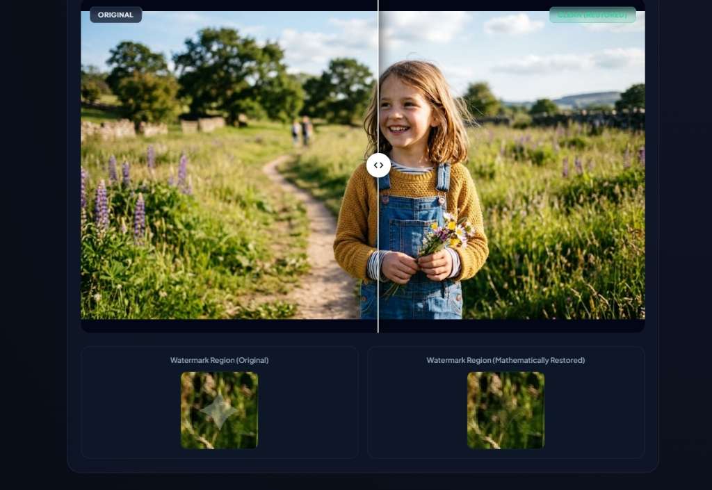
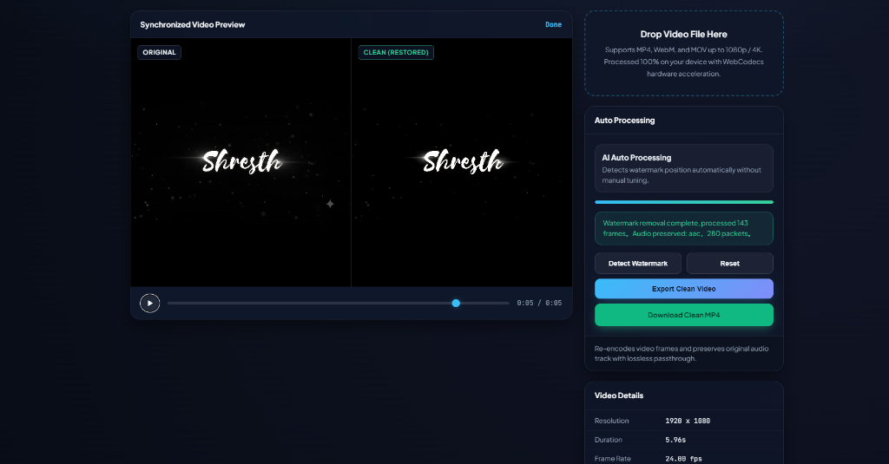

# 🌟 Gemini & Veo Watermark Remover (100% Local & Lossless)

[](https://geminiwatermarkremover-xi.vercel.app/)

[](LICENSE)
[](#)
[](#)
[](#)
[](https://vercel.com/new/clone?repository-url=https%3A%2F%2Fgithub.com%2FShresthzzzz%2Fgemini_watermark_remover)

> 🚀 **Live Demo**: **[https://geminiwatermarkremover-xi.vercel.app/](https://geminiwatermarkremover-xi.vercel.app/)**

A high-performance, 100% client-side web application designed to mathematically unblend and completely remove watermarks from **Google Gemini & Imagen AI images** and **Google Veo AI videos** directly in your browser.

Created with ❤️ by **[Shresth](https://github.com/Shresthzzzz)**.

---

## 📸 Previews

### 🖼️ Image Mode — Real-time Split Comparison & Zoom Inspection
Reverse alpha unblending restores original pixels underneath with zero generative hallucination or blurring.



### 🎬 Video Mode — Synchronized Frame-by-Frame Player
GPU-accelerated WebCodecs processing (`VideoDecoder` / `VideoEncoder`) with temporal stabilization, edge denoising, and audio passthrough.



---

## ✨ Key Features

- **100% Private & Client-Side**: No files or data are ever uploaded to an external server. Everything is decoded, unblended, and encoded inside browser memory.
- **Pure Mathematical Unblending**: Inverts Google's linear alpha transparency blend:
  $$\text{Original} = \frac{\text{Observed} - (\alpha \times \text{LogoColor})}{1 - \alpha}$$
- **✨ De-Bevel / Ridge Smoothing**: Eliminates the 1-pixel embossed directional contour on high-contrast backgrounds.
- **🧼 Flawless Inpaint**: Dirichlet harmonic inpainting solver for seamless, zero-trace results across textures and clothing.
- **🎬 Hardware Accelerated Video**: WebCodecs demuxing, frame extraction at 30/60 fps, AI temporal smoothing, and direct MP4 export with audio preserved.
- **Zero Dependencies Needed**: Runs natively on modern browsers (Chrome, Edge, Brave, Opera).

---

## 🚀 Quick Start Guide

### 🌐 Try Online (No Setup Required)
Access the live deployment directly in your browser:
**👉 [https://geminiwatermarkremover-xi.vercel.app/](https://geminiwatermarkremover-xi.vercel.app/)**

---

### Local Setup (Windows)

#### Method 1: One-Click Run (Easiest)
1. Clone or download this repository:
   ```bash
   git clone https://github.com/Shresthzzzz/gemini_watermark_remover.git
   cd gemini_watermark_remover
   ```
2. Simply double-click **`run.bat`**.
3. It will automatically start a local server and open `http://localhost:8080` in your default browser.

### Method 2: Command Line (PowerShell / Command Prompt)
Run the lightweight built-in Python or Node server:

```powershell
# Using Python
python -m http.server 8080

# Or using Node / npx
npx serve -l 8080
```
Then navigate to **`http://localhost:8080`** in your browser.

---

## 🛠️ Usage Guide

### 🖼️ Removing Watermarks from Images (`index.html`)
1. Open the **Image Remover** tab.
2. Drag & drop your Gemini image (or press `Ctrl + V` to paste from clipboard).
3. The image is unblended in real time (~30ms).
4. **For Tricky Images / Embossed Ridges**:
   - Click **`✨ De-Bevel Edge (Fix Ridge)`** to neutralize perimeter relief lines.
   - Click **`🧼 Flawless Inpaint (Zero Trace)`** to achieve complete background continuity.
   - Use the **Subpixel Shift** sliders (`X / Y`) or click **Auto-Align** to cancel out directional shadows.
5. Click **Download Clean Image** to export full-resolution PNG.

### 🎬 Removing Watermarks from Videos (`video.html`)
1. Switch to the **Video Remover** tab at the top.
2. Drag & drop an MP4, WebM, or MOV video file generated by Gemini or Veo.
3. Click **Export Clean Video**.
4. The engine samples video frames, unblends the watermark, applies temporal stabilization, and re-encodes to MP4.
5. Click **Download Clean MP4**.

---

## 📂 Project Structure

```
gemini_watermark_remover/
│
├── index.html        # Main Image Watermark Remover UI
├── video.html        # Video Watermark Remover UI with synchronized player
├── worker.js         # Optimized Image Web Worker with embedded alpha masks
├── video-app.js      # WebCodecs Video Demuxer, Muxer & Temporal Stabilizer
├── run.bat           # 1-Click Windows Launcher
├── LICENSE           # MIT License
├── README.md         # Documentation & Previews
└── assets/           # Demonstration screenshots & previews
    ├── image_demo.jpg
    └── video_demo.png
```

---

## ⚖️ License

Distributed under the **MIT License**. See [`LICENSE`](LICENSE) for more information.

Developed by **[Shresth](https://github.com/Shresthzzzz)**.
